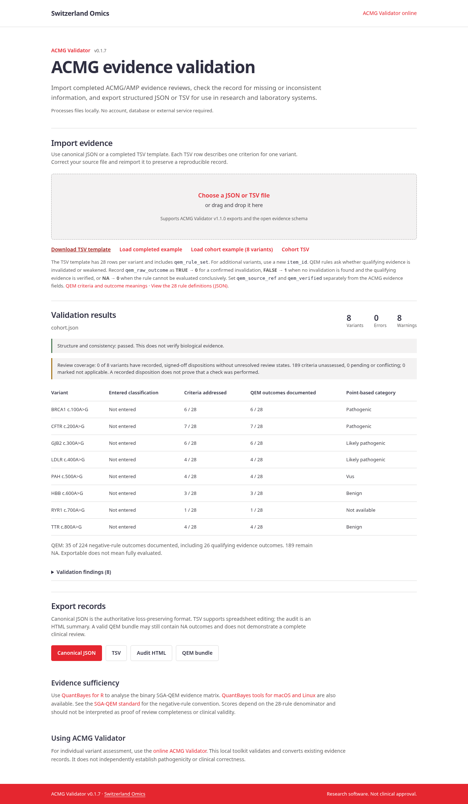

# ACMG Validator

**Version 0.1.7** · [Release history](CHANGELOG.md)

**An open evidence schema and validation toolkit for ACMG/AMP variant reviews.**

Import, validate and convert evidence records using JSON or tab-separated values (TSV). Process one review or a cohort locally. Preserve the distinction between evidence that is present, absent after review, unassessed, conflicting and not applicable. Export a portable evidence audit and an optional experimental SGA-QEM matrix.

[Review a variant online](https://switzerlandomics.ch/technologies/acmg-validator/) · [Data formats](docs/data-formats.md) · [Validation rules](docs/validation.md) · [QEM mapping](docs/qem.md) · [QuantBayes R](docs/quantbayes.md) · [SGA-QEM standard](https://www.swissgenomicsassociation.ch/pages/sga_qem/) · [SQL integration](docs/sql-integration.md)



## Get started

Requires **Node.js 22 or newer**. No third-party packages or database are required. Works on Windows, macOS and Linux.

```bash
npm run start
# Then open http://127.0.0.1:8765/
```

Open **http://127.0.0.1:8765** for drag-and-drop import, validation and downloads. All processing is local, without telemetry or uploads.

Or use the command line directly:

```bash
node bin/acmg-validator.js template --out checklist.tsv
node bin/acmg-validator.js validate checklist.tsv
node bin/acmg-validator.js convert checklist.tsv --to json --out review.json
node bin/acmg-validator.js convert review.json --to tsv --out review.tsv
node bin/acmg-validator.js convert review.json --to html --out review.html
```

For an eight-variant synthetic cohort and a directly usable QuantBayes R input:

```bash
node bin/acmg-validator.js validate examples/cohort.json
node bin/acmg-validator.js qem examples/cohort.json --out-dir output/qem
```

Then in R:

```r
setwd("output/qem")
source("run_quantbayes.R")
res$variants
res$global
plots$p_overlay
plots$p_matrix
plots$p_theta_ci
```

Alternatively, run the matrix directly in R after extracting the QEM bundle:

```r
res <- quantbayes::quant_es_from_binary_table(
  "quantbayes.tsv", variant_col = "variant_id"
)
res$variants
res$global
```

The `variant_col` argument **must** be supplied. Without it, QuantBayes' file reader treats the text identifier as an evidence column. See [QuantBayes integration](docs/quantbayes.md).

For the current version number run `node bin/acmg-validator.js --version`. The legacy website-format conversion remains available only in the CLI: `node bin/acmg-validator.js convert review.json --to site-json --out website-review.json`. This adapter loses dedicated QEM provenance, so it is not the primary JSON format.

For global CLI use after checking out: `npm link`, then use `acmg-validator` in place of `node bin/acmg-validator.js`. `npm link` is optional. To check a completed review more strictly, run `acmg-validator validate review.json --strict`.

## Four capabilities

1. **Import** canonical JSON, completed TSV templates and existing Switzerland Omics ACMG Validator v1 single- or multi-variant JSON exports.
2. **Validate** structure and documentary consistency, then report review coverage separately from what was actually verified.
3. **Export** canonical JSON (primary format), long TSV, a printable HTML audit, or a QEM bundle. A legacy website JSON adapter remains available via CLI only.
4. **Project** qualified evidence into an explicitly versioned, experimental SGA-QEM documentary evidence matrix with the original record attached.

## What the software does not do

It does not annotate or classify variants automatically, verify that clinical evidence is true, diagnose a patient, or establish EHR/FHIR interoperability. The point-based category is only a consistency aid. A validated record means its **structure and declared evidence states** satisfy these software checks, not that a medical interpretation is correct.

This repository is not the browser-based manual review form at Switzerland Omics, and its HTML audit is not identical to the website report. The existing site remains the easiest route for clinicians reviewing a single variant. Bioinformaticians and laboratories can instead use the documented schema and command line. See [website compatibility](docs/data-formats.md#website-compatibility).

Canonical JSON is the primary loss-preserving exchange format. The beginner TSV template omits the optional advanced preservation columns (`record_json` and `criterion_json`). If those columns are present in an exported TSV, the visible columns take precedence, including intentionally cleared cells. For full fidelity of unflattened caveats, prefer canonical JSON. The normalised JSON schema is [`schemas/acmg-evidence.v1.schema.json`](schemas/acmg-evidence.v1.schema.json), using JSON Schema Draft 2020-12. The schema supports database ingestion, but clinical SQL/EHR interfaces require site-specific mapping and governance. For that future work see the [HL7 FHIR Genomics Reporting guide](https://hl7.org/fhir/uv/genomics-reporting/).

## Example data

The `examples/` directory contains only synthetic, non-identifiable data:

- `completed.json`: a signed-off specimen with documented dispositions for every criterion.
- `incomplete.json`: deliberately incomplete evidence to demonstrate warnings.
- `completed.tsv`: the same completed example as a TSV, including round-trip preservation fields.
- `template.tsv`: a blank synthetic 28-criterion template for spreadsheet entry.
- `cohort.json` and `cohort.tsv`: the same eight-variant synthetic dataset, with varying qualifying, invalidated and unassessed evidence checks.
- `qem-rules.tsv`: human-readable versioned rule IDs, invalidating questions and raw outcome meanings.
- `quantbayes.tsv`: a pre-generated 8 × 28 binary QEM example, directly readable with `variant_col = "variant_id"`.

Synthetic attestations and source identifiers are educational placeholders; no real clinical evidence was assessed. The cohort deliberately has unassessed criteria, so validation warnings are expected.

## Browser use

Run `npm run start`, then open **http://127.0.0.1:8765/** in a modern browser. Choose a completed JSON/TSV file, drop it into the import area, or select **Load completed example**. Validation results and the canonical JSON, TSV, HTML audit and QEM download controls appear after import. The **Download TSV template** link works before import. You can load a single-variant example or the eight-variant cohort directly, and download the corresponding TSV. QEM answers are read-only in the browser: update `qem_raw_outcome`, `qem_source_ref` and `qem_verified` in the original JSON/TSV file, then reimport it. The page distinguishes structural validity, recorded review coverage and documented QEM-rule outcomes. A valid QEM matrix may still include unassessed `NA` cells.

If the on-page initialisation warning remains visible, the browser could not load the application modules. Inspect the browser developer console and ensure you are opening the displayed local HTTP address rather than `web/index.html` as a local file.

## Experimental SGA-QEM output

```bash
node bin/acmg-validator.js qem examples/completed.json --out-dir output/qem
```

The QEM bundle contains `matrix.tsv`, `quantbayes.tsv`, `raw_outcomes.tsv`, `rules.json`, `evidence.json`, `run_quantbayes.R` and `README.txt`. The browser packages all seven into one ZIP. The QuantBayes file differs from the original matrix only in its identifier header (`variant_id` versus `item_id`); it preserves the binary cells and rule order exactly. The mapping follows **SGA-QEM-1.0** (`FALSE → 1`, `TRUE → 0`, `NA → 0`) under an explicitly stated documentary rule set; it is **not a pathogenicity assessment**. A `1` requires an explicitly recorded **FALSE** answer to the negative QEM rule, plus a separately documented `qem_source_ref`, `qem_verified` and named signed-off review. ACMG acceptance alone does not establish this answer. Every rule has an explicitly negative question, specified in `src/qem-rules.json`; the local [QEM definitions page](web/qem.html) explains the mapping; see [QEM limitations](docs/qem.md) and the [28-rule polarity audit](docs/qem-rule-audit.md). The input dataset must declare `qem_rule_set: "switzerlandomics.acmg-evidence-availability.v3"` (or the same TSV column); the rule IDs remain unchanged. The revised projection is rule set `switzerlandomics.acmg-evidence-availability.v3`; deprecated PP5/BP6 cannot contribute `1`.

## QEM and QuantBayes

The [SGA-QEM standard](https://www.swissgenomicsassociation.ch/pages/sga_qem/) specifies negatively oriented evidence checks. A QEM `1` requires a documented FALSE outcome with qualifying evidence; TRUE and NA both map to `0` for different reasons. The [QuantBayes R package](https://cran.r-project.org/web/packages/quantbayes/index.html) can estimate evidence sufficiency on the fixed binary matrix. See [QuantBayes tools for macOS and Linux](https://switzerlandomics.ch/technologies/quantbayes/) and [methodological limitations](docs/quantbayes.md). A higher matrix score does **not** prove that all applicable criteria were checked or that a clinical interpretation is correct.

## Testing and publication

```bash
npm run check
```

The project uses the built-in Node test runner, with GitHub Actions on Windows, macOS and Linux. No npm lockfile or dependency installation is required. Review the MIT licence and publisher details before pushing the repository. Do not commit patient data or real laboratory records. `.gitignore` excludes common local private/output directories, but version control exclusions do not replace a data review before publication.

## Attribution

**ACMG Validator** by Switzerland Omics. This repository implements an evidence interchange toolkit compatible with the supplied Switzerland Omics ACMG Validator v1.1.0 export structure. ACMG/AMP criteria and associated interpretation guidance originate from their respective scientific publications and ClinGen SVI updates. The software is MIT licensed. The separate SGA-QEM-1.0 standard is a Swiss Genomics Association work and should be cited independently.
