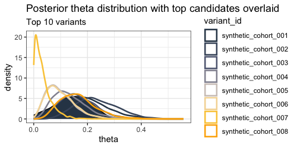

# ACMG Validator CLI

**Version 0.1.9** · [Release history](CHANGELOG.md)  

<!-- [](https://zenodo.org/badge/latestdoi/1470149607) -->
[](https://zenodo.org/records/24584209)

An open evidence schema and validation toolkit for ACMG/AMP variant reviews. Import, validate and convert structured evidence records in JSON or tab-separated values (TSV), for one variant or an entire cohort. The toolkit keeps evidence that is present, absent after review, conflicting, unassessed or not applicable clearly distinct.

[Online manual review tool](https://switzerlandomics.ch/technologies/acmg-validator/) · [Data formats](docs/data-formats.md) · [Validation rules](docs/validation.md) · [TSV column guide](web/columns.html) · [SQL integration](docs/sql-integration.md)


## Get started

Requires **Node.js 22 or newer**. No third-party packages or database are required. Runs locally on Windows, macOS and Linux.

Start the browser interface:

```bash
npm run start
```

Open [http://127.0.0.1:8765/](http://127.0.0.1:8765/) to import JSON or TSV files, inspect validation findings and download results. Processing is local, without accounts, telemetry or data uploads.

Alternatively, use the command line:

```bash
node bin/acmg-validator.js validate examples/completed.json
node bin/acmg-validator.js template --out checklist.tsv
node bin/acmg-validator.js convert examples/completed.json --to tsv --out review.tsv
node bin/acmg-validator.js convert examples/completed.json --to html --out review.html
```

Edit `checklist.tsv` with your own review information before validating it. The completed example is synthetic and can be used to explore the outputs immediately.

## Core workflow

ACMG Validator CLI provides three main operations:

1. **Import** canonical JSON, completed TSV templates or compatible single- and multi-variant JSON exports from the [Switzerland Omics ACMG Validator](https://switzerlandomics.ch/technologies/acmg-validator/).
2. **Validate** the record structure, evidence states and documentary consistency. Review coverage and verification are reported separately.
3. **Export** canonical JSON, TSV or a printable HTML audit. An optional QEM evidence matrix is available for downstream analysis.

Canonical JSON is the primary format for retaining the complete record. The beginner TSV template makes common fields easier to edit, while advanced `record_json` and `criterion_json` columns preserve additional information during full TSV exports. Visible TSV values take precedence when reimported, including intentionally cleared fields; use canonical JSON when full preservation of nested caveats is important.

The canonical schema is [`schemas/acmg-evidence.v1.schema.json`](schemas/acmg-evidence.v1.schema.json) (JSON Schema Draft 2020-12). It can support future database integration, but connecting to SQL, EHR or FHIR systems requires additional mappings and governance. See [data formats](docs/data-formats.md), [SQL integration](docs/sql-integration.md) and the [HL7 FHIR Genomics Reporting guide](https://hl7.org/fhir/uv/genomics-reporting/).

### Command-line options

```bash
node bin/acmg-validator.js --version
node bin/acmg-validator.js validate review.json --strict
node bin/acmg-validator.js convert review.json --to json --out review-copy.json
```

For an optional global command, run `npm link` in the repository and use `acmg-validator` in place of `node bin/acmg-validator.js`.

A legacy website JSON adapter is available through the CLI:

```bash
node bin/acmg-validator.js convert review.json --to site-json --out website-review.json
```

The website format does not preserve dedicated QEM provenance, so it is not the recommended format for archiving or exchanging a complete record. The local HTML audit also differs from the online tool's report. See [website compatibility](docs/data-formats.md#website-compatibility).

## Example data

The `examples/` directory contains synthetic, non-identifiable data:

| File | Purpose |
| --- | --- |
| `template.tsv` | Beginner template with 28 criterion rows, essential fields first, an optional gene and a `coordinate` alternative to `hgvs_c`. |
| `completed.json` and `completed.tsv` | Signed-off example, with all criterion dispositions recorded. The TSV includes round-trip preservation fields. |
| `incomplete.json` | Deliberately incomplete evidence showing how validation warnings are reported. |
| `cohort.json` and `cohort.tsv` | Eight variants with differing evidence availability, confirmed invalidations and unassessed checks. |
| `qem-rules.tsv` and `quantbayes.tsv` | Optional QEM rule reference and a pre-generated eight-variant binary matrix. |

The evidence references and verification attestations are placeholders. No real clinical evidence was assessed, and warnings are expected for the cohort's unassessed criteria.

## Browser workflow

Run `npm run start` and open the local address. Download the TSV template, choose a JSON or TSV file, drag it into the import area or load either synthetic example. The review and export sections are visible before import, but exports remain disabled until a valid record is loaded.

Each TSV row represents one criterion for one variant. The required TSV headers are `item_id`, `criterion`, `status` and `evidence_status`; each variant also needs `hgvs_c` or `coordinate`. The gene symbol is recommended but not mandatory. Edit your source file and reimport it to correct any findings. QEM evaluations are not edited directly in the browser.

The local [ACMG criteria](web/acmg.html), [TSV column guide](web/columns.html) and [QEM criteria](web/qem.html) pages describe the rules, fields and outcomes. If an initialisation warning remains visible, open the local HTTP address rather than `web/index.html` directly and check the browser developer console.

## Scope and limitations

The toolkit validates **record structure and declared evidence states**. It does not annotate or classify variants automatically, confirm that biological evidence is true, diagnose patients or establish clinical validity. Any point-based category is a consistency aid, not a clinical conclusion. The online [manual review tool](https://switzerlandomics.ch/technologies/acmg-validator/) remains available for individual assessments.

## Optional QEM and QuantBayes analysis

QEM and QuantBayes are **optional**. Standard ACMG validation and JSON, TSV or HTML exports do not require either.

The [SGA-QEM standard](https://www.swissgenomicsassociation.ch/pages/sga_qem/) uses negatively worded questions to distinguish confirmed invalidation, verified qualifying evidence and missing information. The experimental 28-rule projection uses the following mapping:

| Raw QEM outcome | Binary value | Meaning |
| --- | ---: | --- |
| `TRUE` | 0 | An invalidating or weakening condition was confirmed. |
| `FALSE` | 1 | The check found no invalidation and qualifying evidence was verified. |
| `NA` | 0 | The check was not conclusively evaluated, was inapplicable or could not be verified. |

A QEM `1` requires an explicit `FALSE` result, a `qem_source_ref`, `qem_verified` and a named, signed-off review. Accepting an ACMG criterion does not automatically establish a QEM result. The original outcomes are preserved, since `TRUE` and `NA` have different meanings even though both produce zero. Read the [QEM mapping](docs/qem.md), [rule polarity audit](docs/qem-rule-audit.md) and [QEM criteria page](web/qem.html) for details.

### Export a QEM bundle

```bash
node bin/acmg-validator.js validate examples/cohort.json
node bin/acmg-validator.js qem examples/cohort.json --out-dir output/qem
```

The bundle contains `matrix.tsv`, `quantbayes.tsv`, `raw_outcomes.tsv`, `rules.json`, `evidence.json`, `run_quantbayes.R` and `README.txt`. The browser downloads these seven files as a ZIP. `quantbayes.tsv` has the same binary values and rule order as `matrix.tsv`, with `variant_id` rather than `item_id` as the identifier column.

The QEM bundle declares its versioned rule set, `switzerlandomics.acmg-evidence-availability.v3`; canonical JSON also declares this identifier. The rules are documentary and experimental, and deprecated PP5/BP6 cannot yield QEM `1`. A valid matrix can contain unassessed `NA` cells and does not prove that all applicable reviews are complete.

### Analyse the example with QuantBayes

QuantBayes is available as a binary for macOS, Linux, and an R package.
You can find the [macOS and Linux versions here](https://switzerlandomics.ch/technologies/quantbayes/).

With the [QuantBayes R package](https://cran.r-project.org/web/packages/quantbayes/index.html) installed, open R in the QEM output directory:

```r
setwd("output/qem")
source("run_quantbayes.R")
res$variants
res$global
plots$p_overlay
plots$p_matrix
plots$p_theta_ci
```

Alternatively, the matrix can be read directly:

```r
res <- quantbayes::quant_es_from_binary_table(
  "quantbayes.tsv", variant_col = "variant_id"
)
res$variants
```

The `variant_col` argument is essential for this file helper; without it, the text identifier is treated as an evidence column. 
For more, see [QuantBayes integration](docs/quantbayes.md) 

### Eight-variant example

A variant interpretation is only as reliable as its supporting evidence. A variant may be classified as pathogenic while relevant checks remain missing, inconclusive or unverified. Evidence sufficiency helps identify those gaps without claiming to measure the probability that the classification is correct.

The eight synthetic variants in `examples/cohort.tsv` were converted into a QEM bundle and analysed with `run_quantbayes.R`. Each variant has 28 binary rules; `k` counts the verified qualifying evidence outcomes.

| Variant | Qualifying checks (k/28) | Posterior mean | 95% credible interval |
| --- | ---: | ---: | ---: |
| synthetic_cohort_001 | 5/28 | 0.200 | 0.080–0.358 |
| synthetic_cohort_002 | 6/28 | 0.233 | 0.103–0.397 |
| synthetic_cohort_003 | 4/28 | 0.167 | 0.059–0.317 |
| synthetic_cohort_004 | 3/28 | 0.133 | 0.039–0.274 |
| synthetic_cohort_005 | 2/28 | 0.100 | 0.022–0.228 |
| synthetic_cohort_006 | 2/28 | 0.100 | 0.022–0.228 |
| synthetic_cohort_007 | 0/28 | 0.033 | 0.001–0.119 |
| synthetic_cohort_008 | 4/28 | 0.167 | 0.059–0.317 |

The cohort mean posterior estimate was **0.142** and the median **0.150**. The 2.5th and 97.5th percentiles of the eight posterior means were **0.045** and **0.228**. The 95% credible interval for each variant reflects uncertainty in the estimated evidence sufficiency, not uncertainty in its clinical classification. Under this 28-rule model, a variant with qualifying evidence for every rule would have a posterior mean close to 1.



QuantBayes estimates evidence sufficiency relative to the **specified set of rules**. Scores are sensitive to how many rules apply to a given variant, so they should not be interpreted as proof that its review is complete or its classification is correct.

For the method, see [*A Bayesian model for quantifying genomic variant evidence sufficiency in Mendelian disease*](https://doi.org/10.1101/2025.12.02.25341503), Quant Group, Ali Saadat, Shweta Pipaliya and Dylan Lawless, *medRxiv* preprint (2025). [PDF](https://www.medrxiv.org/content/10.64898/2025.12.02.25341503v2.full.pdf) · [R package](https://cran.r-project.org/package=quantbayes) · [Application](https://switzerlandomics.ch/technologies/quantbayes/).

## Testing and publication

```bash
npm run check
```

Tests use the built-in Node test runner, with GitHub Actions on Windows, macOS and Linux. No npm lockfile or third-party dependency installation is needed. Do not commit patient data or identifiable laboratory records. `.gitignore` excludes common local private and output directories, but these exclusions do not replace a manual data review before publication.

## Contributing

Contributions are welcome, particularly from researchers, clinical geneticists and developers who can test the approach with their own datasets, assess the evidence representation or extend it to other clinical and scientific domains.

We also welcome interoperability work, including mappings to GA4GH standards, HL7 FHIR and electronic health record (EHR) systems. Please open a GitHub issue to discuss an idea, report a problem or propose an improvement.

## Attribution

**ACMG Validator CLI** is an open-source project. It provides an evidence interchange toolkit compatible with the Switzerland Omics ACMG Validator v1.1.0 export structure. ACMG/AMP criteria and interpretation guidance originate from the respective scientific publications and ClinGen SVI updates. The software is MIT licensed. The separate [SGA-QEM-1.0 standard](https://www.swissgenomicsassociation.ch/pages/sga_qem/) is a Swiss Genomics Association work and should be cited independently.

## Citation

If you use ACMG Validator CLI in your research, please cite the
corresponding software release.

Lawless D. *ACMG Validator CLI: Structured ACMG/AMP Variant Evidence
Validation and Exchange*. Version 0.1.9. Zenodo. 2026.
https://doi.org/10.5281/zenodo.24584209

### BibTeX

```bibtex
@misc{lawless2026acmgvalidatorcli,
  author       = {Lawless, Dylan},
  title        = {{ACMG Validator CLI}: Structured {ACMG/AMP} Variant Evidence Validation and Exchange},
  year         = {2026},
  howpublished = {Zenodo, version 0.1.9},
  version      = {0.1.9},
  doi          = {10.5281/zenodo.24584209},
  url          = {https://github.com/DylanLawless/acmg-validator},
  note         = {doi: 10.5281/zenodo.24584209}
}
```


